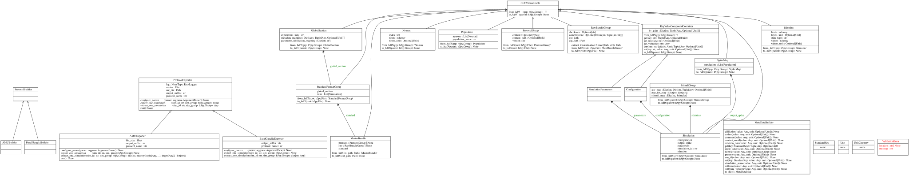
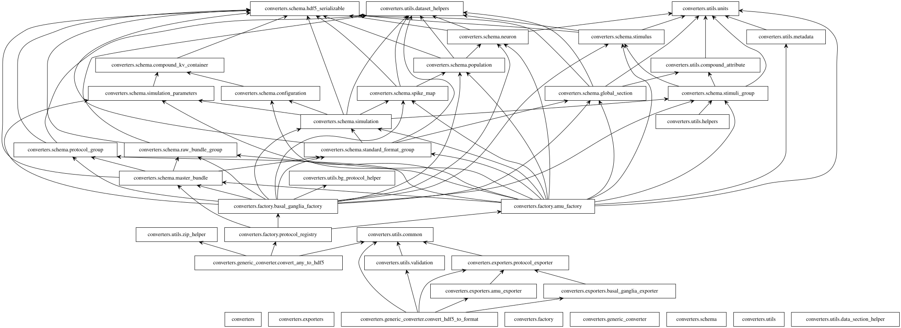
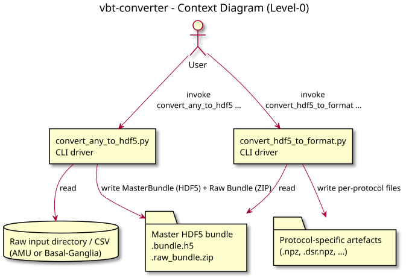
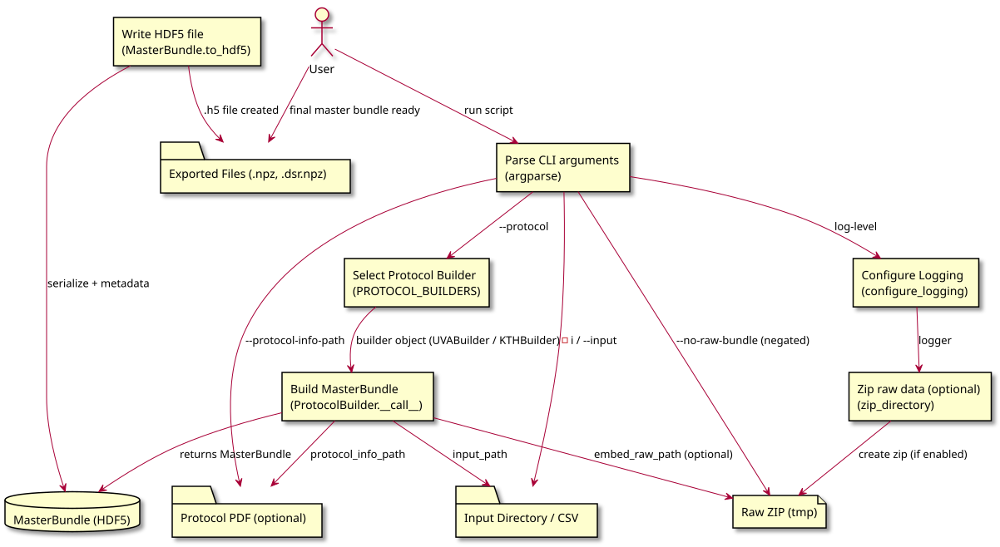
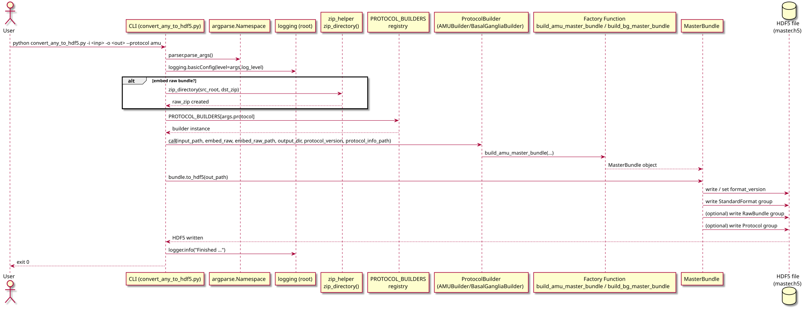
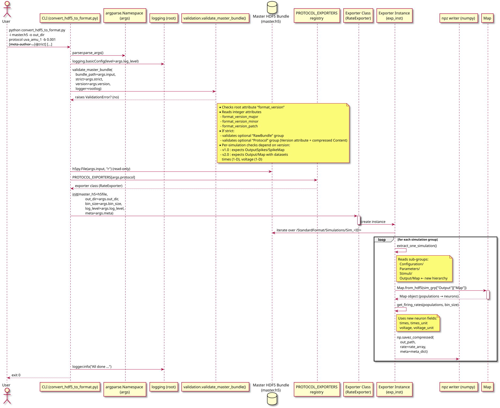
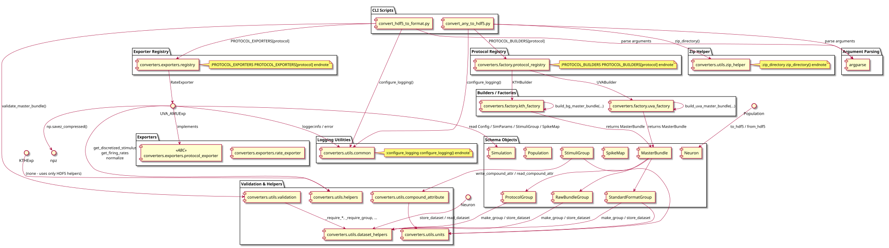

# Design Documentation

This **docs/Readme.md** is a quick‑start guide to the generated documentation for **vbt‑converter**.  
It provides a visual overview of the project’s architecture, data flow and execution sequences.

---

## High‑level Class UML diagrams

| Diagram      | Rendered view                                                                    |
|--------------|----------------------------------------------------------------------------------|
| **Classes**  |    |
| **Packages** |  |

---

## Data‑flow diagrams (DFD)

| Level                    | Diagram                                                      |
|--------------------------|--------------------------------------------------------------|
| **Level 0 – High‑level** |  |
| **Level 1 – Detailed**   |  |

These diagrams illustrate how data moves through the converter, from raw input directories to the final
protocol‑specific exports.

---

## Sequence diagrams

| Use‑case                                      | Diagram                                                                                                   |
|-----------------------------------------------|-----------------------------------------------------------------------------------------------------------|
| **Directory → HDF5** (parameter‑sweep import) |              |
| **HDF5 → Protocol format** (export)           |  |

These sequences detail the step‑by‑step interaction of the CLI commands and the internal conversion pipeline.

---

## Component‑Interaction Overview

| Diagram                    | Rendered view                                                                              |
|----------------------------|--------------------------------------------------------------------------------------------|
| **Component interactions** |  |

The component‑interaction view ties together the builders, exporters, factories and helper modules that make up the
whole system.